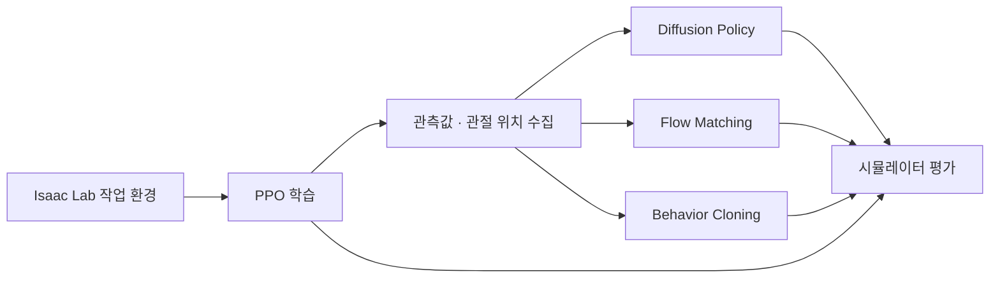

# RB5 Robot Learning

**Isaac Lab 기반 RB5 로봇 강화학습 · 데이터 수집 · 모방학습 실험**

RB5-850E 로봇과 Robotiq Hand-E 그리퍼로 목표 지점에 도달하고 물체를 들어 올리는 동작을 학습합니다. PPO로 학습한 로봇의 동작을 데이터로 저장하고, **Diffusion Policy**, **Flow Matching**, **Behavior Cloning(BC)** 정책을 학습·평가하는 연구용 코드입니다.

> 이 저장소에는 소스 코드와 모델 구조 그림이 포함됩니다. 실행하려면 Isaac Lab 환경과 별도의 로봇 USD 파일이 필요합니다. 학습 데이터, 학습된 모델, 정규화 통계 파일은 포함되지 않습니다.

## 주요 기능

- **강화학습:** RSL-RL PPO로 Reach, Reach & Lift, Pick & Place 작업 학습
- **데이터 수집:** PPO 정책을 실행하면서 관측값과 실제 로봇 관절 위치 저장
- **모방학습:** Diffusion Policy, Flow Matching, BC를 이용한 연속 동작 예측
- **동작 묶음 비교:** 한 번에 예측할 동작 수와 실제 실행할 동작 수를 바꾸며 평가
- **평가 지표:** 성공률, 목표까지의 거리, 물체 높이, 이동 경로 길이, 동작 변화량, 추론 시간



## 작업 환경

환경 이름은 [`task/__init__.py`](task/__init__.py)에 등록되어 있습니다.

| 환경 이름 | 용도 |
| --- | --- |
| `reach` | 로봇 끝부분을 목표 위치와 자세로 이동시키는 강화학습 |
| `reach_lift` | 물체에 접근해 잡고 들어 올리는 강화학습 |
| `pick_and_place` | 물체를 집어 목표 위치로 옮기는 강화학습 |
| `reach_imitation` | Reach 모방학습 정책 실행 및 평가 |
| `reach_lift_imitation` | Reach & Lift 모방학습 정책 실행 및 평가 |
| `reach_lift_play`, `pick_and_place_play` | 강화학습 정책 재생용 환경 |
| `reach_lift_skrl` | SKRL PPO 설정을 사용하는 Reach & Lift 환경 |

모방학습의 주요 비교 대상은 `reach`와 `reach_lift`입니다. `launch/skrl_train.py`와 `launch/skrl_play.py`도 포함되어 있으며, SKRL 실행 시 해당 라이브러리와 환경 등록 설정이 필요합니다.

## 폴더 구조

```text
only_robot_rl_2/
├── launch/                    # 강화학습, 데이터 수집, 정책 재생 및 평가
├── task/                      # 작업별 환경, 관측값, 보상, 종료 조건
│   ├── reach/
│   ├── reach_lift/
│   ├── pick_and_place/
│   ├── reach_imitation/
│   └── reach_lift_imitation/
├── robot/                     # RB5 로봇과 그리퍼 설정
├── policy_models/
│   ├── diffusion/             # Diffusion Policy 및 초기 실험 노트북
│   ├── flow_match/            # Flow Matching 학습 및 실행 래퍼
│   ├── bc/reach_lift/         # Reach와 Reach & Lift 공용 BC 구현
│   └── architecture_diagrams/ # 모델 구조 SVG와 생성 스크립트
├── scripts/                   # 반복 학습 및 평가용 셸 스크립트
├── various_seed_result.md     # 여러 평가 seed의 실험 기록
├── pyproject.toml             # 일반 Python 학습 환경의 의존성
└── uv.lock                    # 의존성 버전 기록
```

## 실행 준비

### 1. 저장소 받기

```bash
git clone https://github.com/kim-1210/only_robot_rl_2.git
cd only_robot_rl_2
export PYTHONPATH="$PWD${PYTHONPATH:+:$PYTHONPATH}"
```

아래 명령은 모두 저장소 최상위 폴더에서 실행합니다.

### 2. Python 학습 환경

모방학습 모델 훈련에는 `uv`로 프로젝트 전용 가상환경을 만들 수 있습니다.

```bash
uv sync --locked
uv run python -c "import torch, numpy; print('PyTorch:', torch.__version__); print('CUDA:', torch.cuda.is_available())"
```

패키지는 프로젝트의 `.venv`에 설치됩니다. 전역 `pip install`은 사용하지 않습니다.

[`pyproject.toml`](pyproject.toml)은 Python `>=3.10`, PyTorch `>=2.10.0`, TensorBoard `>=2.20.0`, tqdm `>=4.67.3`, setuptools `==79.0.1`을 선언합니다. GPU로 학습하려면 설치된 PyTorch와 호환되는 NVIDIA 드라이버 및 CUDA 실행 환경이 필요합니다.

### 3. Isaac Lab 시뮬레이션 환경

로봇 시뮬레이션은 **Isaac Sim과 Isaac Lab이 설치된 별도 실행 환경**에서 실행합니다. `uv sync`만으로 Isaac Lab이나 RSL-RL이 설치되지는 않습니다.

- 사용하는 Isaac Lab 버전과 맞는 Python 및 PyTorch 환경을 준비합니다.
- `isaaclab`, `isaaclab_assets`, `isaaclab_tasks`, `isaaclab_rl`을 사용할 수 있어야 합니다.
- PPO 학습 스크립트는 `rsl-rl-lib >=3.0.1`을 확인합니다.
- 이 저장소는 Isaac Sim / Isaac Lab의 정확한 버전을 고정하지 않습니다.

아래 경로를 자신의 Isaac Lab 설치 위치로 바꿉니다.

```bash
export ISAACLAB_PATH="/absolute/path/to/IsaacLab"
```

이후 시뮬레이션 명령은 `"$ISAACLAB_PATH/isaaclab.sh" -p ...`, 모방학습 훈련 명령은 `uv run python ...` 형태로 실행합니다. 기존 코드 주석의 `isaaclab`, `isaaclab_4`는 작성자의 로컬 실행 명령이므로 자신의 실행 환경에 맞춰 바꿔야 합니다.

### 4. 로봇 모델 경로 설정

[`robot/rb5_gripper.py`](robot/rb5_gripper.py)의 `RB5_850E_HAND_E_CFG.spawn.usd_path`는 로컬 절대 경로를 사용합니다. 이를 자신이 준비한 **RB5-850E + Hand-E 조합 USD 파일**의 경로로 수정해야 합니다. USD가 참조하는 메시와 관련 파일도 함께 필요합니다.

모델은 코드에서 사용하는 `base`, `shoulder`, `elbow`, `wrist1`~`wrist3`, 좌우 그리퍼 관절과 `ee_link` 등의 이름에 맞아야 합니다. 그리퍼의 mimic 관계도 사용하므로 다른 로봇 파일을 그대로 대체하면 설정 수정이 필요할 수 있습니다.

예측 관절 위치를 로봇 끝부분의 경로로 변환하는 기능에는 추가로 **Pinocchio**와 로봇 **URDF**가 필요합니다. 경로 탐색 위치는 [`launch/imitation_play_fixed.py`](launch/imitation_play_fixed.py)의 `_resolve_fk_urdf_path()`에서 확인할 수 있습니다. `--disable_predicted_path_viz`는 예측 경로 표시를 끕니다. URDF/Pinocchio가 없으면 저장된 예측 끝점 경로가 0으로 채워질 수 있으므로 해당 배열을 실제 경로로 해석하면 안 됩니다.

## 기본 실행 흐름: Reach

아래는 **PPO 학습 → 데이터 수집 → 모방학습 → 평가**를 연결하는 예시입니다. 환경 수와 배치 크기는 GPU 메모리에 맞춰 조절합니다. 명령의 체크포인트 경로는 실제 학습 결과로 바꿔야 합니다.

### 1. PPO 학습

```bash
"$ISAACLAB_PATH/isaaclab.sh" -p launch/rsl_rl_train.py \
  --task reach \
  --num_envs 1024 \
  --max_iterations 10000 \
  --seed 42
```

이 스크립트는 기본적으로 화면 없이 실행합니다. 시뮬레이션 화면을 보려면 `--ui`를 추가합니다. 결과는 `logs/rsl_rl/rb5_850_reach_task/` 아래에 저장됩니다. 다른 작업은 `--task reach_lift` 또는 `--task pick_and_place`로 선택합니다.

### 2. PPO 동작 데이터 수집

```bash
"$ISAACLAB_PATH/isaaclab.sh" -p launch/get_data_task.py \
  --task reach \
  --checkpoint /absolute/path/to/model.pt \
  --num_envs 100 \
  --max_episode 1000 \
  --save_path ./datas \
  --save_name reach_data1 \
  --seed 42 \
  --headless
```

생성되는 파일은 다음과 같습니다. 이미 같은 이름의 데이터 폴더가 있으면 수집을 진행하지 않으므로 새 이름을 지정합니다.

```text
datas/reach_data1/
├── obs_ep_000001.npy   # 시간에 따른 관측값
├── act_ep_000001.npy   # 시간에 따른 실제 관절 위치
├── obs_ep_000002.npy
├── act_ep_000002.npy
└── meta.npz
```

`act_ep_*.npy`는 PPO가 출력한 원래 제어 명령이 아니라, 수집 코드가 기록한 **실제 로봇 관절 위치**입니다. 같은 에피소드 번호의 관측 파일과 동작 파일을 짝으로 사용합니다.

### 3. 모방학습 정책 훈련

Reach의 Diffusion / Flow Matching 학습기는 `DATA_ROOT`, `OBS_DIR`, `ACT_DIR` 환경변수를 받습니다. 아래는 방금 수집한 평평한 폴더 구조를 그대로 사용하는 예시입니다. 경로를 명시해 학습기의 기본 경로에 의존하지 않도록 합니다.

**Diffusion Policy**

```bash
DATA_ROOT="$PWD/datas/reach_data1" \
OBS_DIR="$PWD/datas/reach_data1" \
ACT_DIR="$PWD/datas/reach_data1" \
CHUNK_SIZE=16 BATCH_SIZE=512 NUM_EPOCHS=150 NUM_WORKERS=4 \
SAVE_DIR_OVERRIDE="$PWD/artifacts/reach_diffusion" \
uv run python policy_models/diffusion/reach/train.py
```

**Flow Matching**

```bash
DATA_ROOT="$PWD/datas/reach_data1" \
OBS_DIR="$PWD/datas/reach_data1" \
ACT_DIR="$PWD/datas/reach_data1" \
CHUNK_SIZE=16 BATCH_SIZE=512 NUM_EPOCHS=150 NUM_WORKERS=4 \
MODEL_ARCH=stanford_dp \
SAVE_DIR_OVERRIDE="$PWD/artifacts/reach_flow_match" \
uv run python policy_models/flow_match/reach/train.py
```

**Behavior Cloning**

BC 구현은 `bc/reach_lift/`에 있지만 `TASK_FAMILY`로 Reach도 선택할 수 있습니다.

```bash
TASK_FAMILY=reach DATA_ROOT="$PWD/datas/reach_data1" \
ACTION_MODE=mean CHUNK_SIZE=16 \
BATCH_SIZE=512 NUM_EPOCHS=150 NUM_WORKERS=4 \
SAVE_DIR_OVERRIDE="$PWD/artifacts/reach_bc" \
CHECKPOINT_FILENAME=reach_bc.pt STATS_FILENAME=reach_bc_stats.npz \
uv run python policy_models/bc/reach_lift/bc_baseline.py train
```

학습 결과에는 모델 가중치 `.pt`, 데이터 정규화 통계 `.npz`, 학습 로그가 포함됩니다. 평가할 때는 **같은 학습 실행에서 나온 모델과 통계 파일**을 함께 사용합니다. 각 학습기는 원본 에피소드에서 동작 묶음을 구성하므로 이 흐름에는 별도 chunk 변환이 필요하지 않습니다. 기존 변환 도구는 `launch/data_make_action_transaction.py`에 있습니다.

### 4. 모방학습 정책 평가

앞 단계에서 학습한 Flow Matching 정책을 실행하는 예시입니다.

```bash
"$ISAACLAB_PATH/isaaclab.sh" -p launch/imitation_play_fixed_left_right.py \
  --task reach_imitation \
  --policy_type python \
  --policy_path ./policy_models/flow_match/reach/policy_wrapper.py \
  --policy_checkpoint ./artifacts/reach_flow_match/reach_flow_match.pt \
  --policy_stats ./artifacts/reach_flow_match/reach_flow_match_stats.npz \
  --num_envs 100 \
  --output_horizon 16 \
  --execute_horizon 14 \
  --episode_length_s 50 \
  --success_dist 0.02 \
  --episodes 100 \
  --seed 50 \
  --device cuda:0 \
  --save_path ./outputs/reach_flow_match_eval.npz \
  --no_auto_report \
  --disable_predicted_path_viz \
  --headless
```

| 옵션 | 의미 |
| --- | --- |
| `--output_horizon N` | 한 번에 예측하는 동작 수. 학습 때의 `CHUNK_SIZE`와 맞춥니다. |
| `--execute_horizon k` | 새로 예측하기 전까지 사용하는 동작 수. `1 ≤ k ≤ N`으로 설정합니다. |
| `--success_dist` | Reach 성공으로 판단하는 목표 거리, 단위는 m |
| `--success_z` | Reach & Lift 성공으로 판단하는 물체의 월드 좌표 높이, 단위는 m |
| `--save_path` | 평가 지표와 동작 경로를 저장할 `.npz` 경로 |
| `--no_auto_report` | 로컬 비교 Markdown 파일에 결과를 자동으로 덧붙이지 않음 |

예를 들어 `N=16`, `k=14`는 16개 동작을 예측한 뒤 앞의 14개를 실행하고 다시 예측한다는 뜻입니다. 실행기는 관절 도달 여부와 유지 시간도 처리하므로 `k`를 시뮬레이터의 프레임 수와 같다고 보면 안 됩니다.

Diffusion을 평가하려면 래퍼를 `policy_models/diffusion/reach/policy_wrapper.py`로, 모델과 통계를 `artifacts/reach_diffusion/reach_diffusion_unet.pt`, `artifacts/reach_diffusion/reach_diffusion_stats.npz`로 변경합니다. BC는 `policy_models/bc/reach_lift/bc_baseline.py` 자체가 정책 래퍼이며, 위 예시의 `reach_bc.pt`와 `reach_bc_stats.npz`를 사용합니다.

### 5. PPO 기준 성능 평가

```bash
"$ISAACLAB_PATH/isaaclab.sh" -p launch/rsl_rl_eval_metrics.py \
  --task reach \
  --checkpoint /absolute/path/to/model.pt \
  --num_envs 100 \
  --episodes 100 \
  --episode_length_s 50 \
  --success_dist 0.02 \
  --seed 50 \
  --save_path ./outputs/reach_ppo_eval.npz \
  --headless
```

비교할 때는 성공 기준, 평가 seed, 에피소드 수, 제한 시간을 맞춥니다. PPO의 제어 명령과 모방학습의 관절 위치는 표현이 다르므로 동작 변화량 수치를 비교할 때도 평가 코드의 계산 방식을 확인해야 합니다.

## Reach & Lift 설정

Reach & Lift는 물체 위치와 최근 관측 이력을 사용하며, 잡기·들기 구간에 가중치를 주는 설정이 포함됩니다.

| 정책 | 학습 파일 | 설정 방식 |
| --- | --- | --- |
| Diffusion | [`policy_models/diffusion/reach_lift/train.py`](policy_models/diffusion/reach_lift/train.py) | 파일의 `Config` 수정. 현재 chunk 8, batch 1024, epoch 500. Reach 예시의 환경변수 설정은 적용되지 않습니다. |
| Flow Matching | [`policy_models/flow_match/reach_lift/train.py`](policy_models/flow_match/reach_lift/train.py) | `CHUNK_SIZE`, `BATCH_SIZE`, `NUM_EPOCHS`, `ACTION_MODE`, `SAVE_DIR_OVERRIDE` 등의 환경변수. 데이터 경로는 `Config` 확인 |
| BC | [`policy_models/bc/reach_lift/bc_baseline.py`](policy_models/bc/reach_lift/bc_baseline.py) | `TASK_FAMILY=reach_lift`, `DATA_ROOT` 등의 환경변수와 `train` 명령 |

Diffusion / Flow Matching의 Reach & Lift 학습기는 기본적으로 다음 구조를 기대합니다. 수집 직후에는 파일이 한 폴더에 있으므로 각각 `obs/`, `actions/`로 정리해야 합니다.

```text
datas/reach_lift_data1/
├── obs/obs_ep_000001.npy
└── actions/act_ep_000001.npy
```

`ACTION_MODE=mean`은 좌우 그리퍼를 하나의 값으로 표현하고, `ACTION_MODE=lr`은 좌우를 구분합니다. 정책끼리 비교할 때는 동작 표현, 모델 구조, 관측 이력, 학습 설정을 함께 확인합니다. 평가 환경은 `reach_lift_imitation`이며, 성공 높이는 `--success_z`로 명시합니다.

## 모델 구조와 실험 기록

- [Reach Diffusion 구조](policy_models/architecture_diagrams/reach_diffusion_architecture.svg)
- [Reach Flow Matching 구조](policy_models/architecture_diagrams/reach_flow_matching_architecture.svg)
- [Reach & Lift Diffusion 구조](policy_models/architecture_diagrams/reach_lift_diffusion_architecture.svg)
- [Reach & Lift Flow Matching 구조](policy_models/architecture_diagrams/reach_lift_flow_matching_architecture.svg)
- [여러 평가 seed의 실험 기록](various_seed_result.md)

그림과 실험 기록은 특정 설정에서 작성된 자료입니다. 현재 학습 설정과 다를 수 있으므로 코드의 `Config`, 체크포인트 설정, 평가 명령을 함께 확인합니다. 기록에 연결된 원본 데이터 파일은 이 저장소에 포함되지 않습니다.

`scripts/`에는 반복 학습과 평가 조합 실행용 스크립트가 있습니다. 실행 전에 상단의 작업 폴더 경로, Isaac Lab 실행 명령, 모델·통계 파일 경로를 자신의 환경에 맞춰 수정해야 합니다.

## 저장소에 포함하지 않는 파일

[`.gitignore`](.gitignore)에서 로컬 연구 메모, 논문 작업 폴더, `novelty/`를 제외합니다. 데이터(`datas/`), 실험 결과(`logs/`, `outputs/`, `artifacts/`), 가상환경, 모델 가중치, 정규화 통계, 캐시와 백업도 Git으로 관리하지 않습니다. 해당 파일은 로컬에 보관하며, 새로 받은 저장소에서는 직접 생성하거나 별도로 준비해야 합니다.

## 자주 확인할 문제

| 증상 | 확인할 내용 |
| --- | --- |
| `No module named isaaclab` | 시뮬레이션 명령을 Isaac Lab이 설치된 실행 환경에서 호출했는지 확인 |
| `No module named task` 또는 `robot` | 저장소 최상위 폴더에서 `PYTHONPATH`를 설정했는지 확인 |
| 로봇 USD를 찾을 수 없음 | `robot/rb5_gripper.py`의 `usd_path`와 USD가 참조하는 파일 확인 |
| 학습용 에피소드를 찾을 수 없음 | 데이터 경로, `obs_ep_*.npy` / `act_ep_*.npy`의 번호, 폴더 구조 확인 |
| 모델 또는 관측값 크기가 맞지 않음 | 작업 종류, chunk 크기, 관측 이력, `ACTION_MODE`, 체크포인트·통계 파일 조합 확인 |
| GPU 메모리 부족 | 시뮬레이션의 `--num_envs` 또는 학습의 배치 크기를 줄임 |
